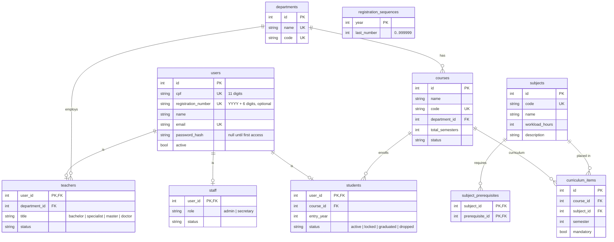

# Data model

Source of truth: the TypeORM entities in `api/src/features/**/entities/`.
SQL reference: `api/sql/schema.sql`. Design rationale: `tasks/03-modelo-de-dados.md`.

## Profiles and roles

A person is one row in `users`. Having a profile means having a row in the
matching table, so roles are **derived**, never stored:

| Role | Derived from |
|------|--------------|
| `admin` / `secretary` | `staff.role` |
| `teacher` | a row in `teachers` |
| `student` | a row in `students` |

A user can have several profiles or none (see "users without link" in the
task). Roles are resolved on every request (never stored in the token), so
deactivating a user or a profile takes effect immediately. A staff or teacher
profile grants its role only while `status = 'active'`; a student grants
`student` unless the status is `dropped`.

## Registration number (matrícula)

`users.registration_number`: `YYYY` + 6 sequential digits, e.g. `2026000123`.
It must not have 11 digits so it can never be confused with a CPF at login.
`registration_sequences` keeps the last number issued per year; the
transaction that creates a user increments it, so numbers are never reused.

## Deletion rules

| Relation | On delete |
|----------|-----------|
| `staff`, `teachers`, `students` → `users` | `CASCADE` (a profile does not outlive its user) |
| `courses` → `departments`, `teachers` → `departments` | `RESTRICT` |
| `students` → `courses` | `RESTRICT` |
| `curriculum_items` → `courses` | `CASCADE` |
| `curriculum_items` → `subjects` | `RESTRICT` |
| `subject_prerequisites.subject_id` → `subjects` | `CASCADE` |
| `subject_prerequisites.prerequisite_id` → `subjects` | `RESTRICT` |

To end a relationship, services set `status` to inactive instead of deleting.
