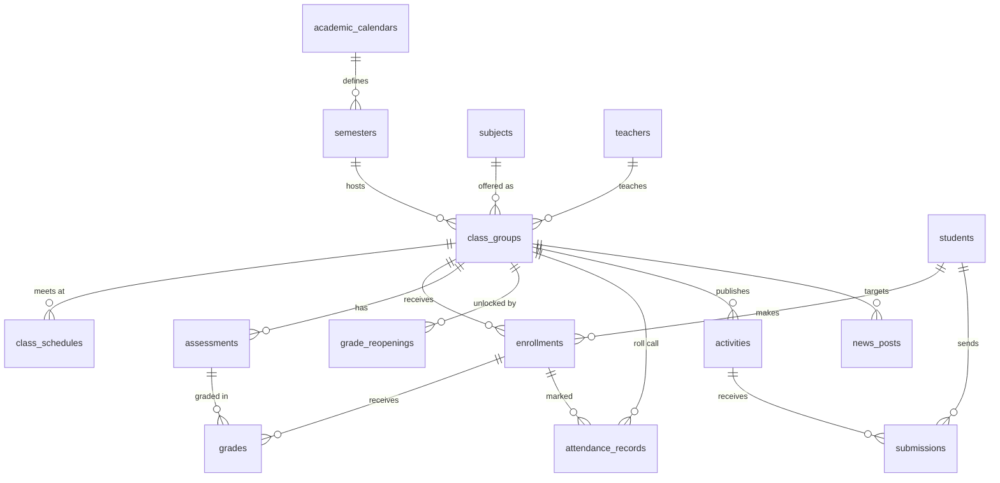

# Data model

Source of truth: the TypeORM entities in `api/src/features/**/entities/`.
SQL reference: `api/sql/schema.sql`. Design rationale: `tasks/03-modelo-de-dados.md`.

## Profiles and roles

A person is one row in `users`. Having a profile means having a row in the
matching table, so roles are **derived**, never stored:

| Role | Derived from |
|------|--------------|
| `admin` / `secretary` | `staff.role` |
| `teacher` | a row in `teachers` |
| `student` | a row in `students` |

A user can have several profiles or none (see "users without link" in the
task). Roles are resolved on every request (never stored in the token), so
deactivating a user or a profile takes effect immediately. A staff or teacher
profile grants its role only while `status = 'active'`; a student grants
`student` unless the status is `dropped`.

## Registration number (matrícula)

`users.registration_number`: `YYYY` + 6 sequential digits, e.g. `2026000123`.
It must not have 11 digits so it can never be confused with a CPF at login.
`registration_sequences` keeps the last number issued per year; the
transaction that creates a user increments it, so numbers are never reused.

## Deletion rules

| Relation | On delete |
|----------|-----------|
| `staff`, `teachers`, `students` → `users` | `CASCADE` (a profile does not outlive its user) |
| `courses` → `departments`, `teachers` → `departments` | `RESTRICT` |
| `students` → `courses` | `RESTRICT` |
| `curriculum_items` → `courses` | `CASCADE` |
| `curriculum_items` → `subjects` | `RESTRICT` |
| `subject_prerequisites.subject_id` → `subjects` | `CASCADE` |
| `subject_prerequisites.prerequisite_id` → `subjects` | `RESTRICT` |

To end a relationship, services set `status` to inactive instead of deleting.

## Semester operations

Added by tasks 21-30 (see `tasks/21-38-conformidade-com-a-especificacao.md`). The enrollment (*inscrição*)
is never called "matrícula", which stays the person's identifier.

| Table | Purpose | Rules enforced in the database |
|-------|---------|--------------------------------|
| `academic_calendars` | Period and the three deadlines (enrollment window, withdrawal, grades) | `start < end`, `enrollment_start <= enrollment_end` |
| `semesters` | A term (`year`, `term` 1 or 2) with status `draft`, `active`, `closed` | `UNIQUE(year, term)` |
| `class_groups` | A *turma*: subject + semester, seats, teacher, status `pending`, `approved`, `rejected`, `closed` | `seats >= 1`, `UNIQUE(semester, subject, code)` |
| `class_schedules` | Weekly meetings (ISO weekday, `HH:MM`) | weekday 1-7, `start < end` |
| `enrollments` | A student in a class; status `requested`, `not_allocated`, `confirmed`, `cancelled`, `locked`, `approved`, `failed_grade`, `failed_attendance` | `UNIQUE(student, class)` |
| `assessments`, `grades` | Weighted evaluations and one grade per enrollment | `weight > 0`, `UNIQUE(enrollment, assessment)` |
| `grade_reopenings` | Justified request to post grades after the deadline (RN14) | status check |
| `attendance_records` | Presence per enrollment per lesson date | `UNIQUE(enrollment, lesson_date)` |
| `activities`, `submissions` | Work with a deadline and the students' deliveries | `UNIQUE(activity, student)` |
| `news_posts` | Notices; no class means the whole institution | |
| `institution_settings` | Minimum passing grade (default 6) | |
| `audit_log` | Append-only trail of critical actions | |

Rules that cannot be a CHECK (they depend on other rows or on the clock) live in services and are covered by
`api/test/*.e2e-spec.ts`: no teacher or student schedule overlap, seat count at confirmation (inside the
serialized `TransactionService`), prerequisites approved, seats never below the enrolled students, grade range,
no attendance on future dates, grade and withdrawal deadlines.

A student's **result** is derived (`api/src/common/domain/results.ts`): weighted average on a 0-10 scale; failing
by attendance above 25 % of the recorded lessons wins over any grade. Finalizing a class (`POST
/classes/:id/finalize`) stores `approved`, `failed_grade` or `failed_attendance` on the enrollment, which is what
later prerequisite checks read.

### Enrollment in two phases

`POST /enrollments` creates an enrollment with status `requested`, which holds **no seat**: it is not on the roll,
has no grades and is not in the panel. When the enrollment period of the calendar has ended, the allocation runs (the Administration can also trigger it)
`POST /semesters/:id/allocate` (it also runs by itself: a timer, when a student lists their enrollments, and
after the clock moves; `AUTO_ALLOCATE=false` disables it). For each class, the requests are ranked (mandatory in the student's curriculum, then
older entry year, then earlier request, then lower id; `api/src/common/domain/allocation.ts`) and the free seats go
to the first ones (`confirmed`); the rest become `not_allocated`. A request can be cancelled until then.
