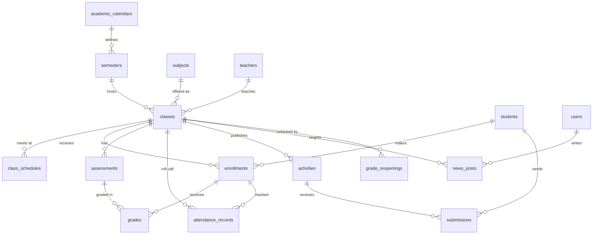

# Spec compliance: gap analysis and change plan

Source: `Report.pdf`, *Especificação de Requisitos do Software: Gestão Acadêmica* (37 pages, November 2026).
Compared against: `main` at `fb2370c` (tasks 01–20 done).

> **Status (implemented on branch `feature/spec-compliance`).** Everything in §9 was built except the items listed
> under "Not done" below. What was done, the decisions taken and the deviations from this plan are recorded in
> Portuguese in `tasks/21-38-conformidade-com-a-especificacao.md`. The sections below are the original analysis and
> plan, kept as written.
>
> **Not done:** TypeORM migrations (task 21), a load-test script and cross-browser runs beyond Firefox (task 38),
> screens for the minimum passing grade and the audit log (API only), versioned curricula (D3).
> **Deviations:** one branch instead of one per task and no merge into `main`; classes are `class_groups` in code
> (D4); the Administration may open a grade window directly (D10); the PDF writer is hand-made; OpenAPI lists routes
> without body schemas. Two public routes that leaked or overwrote account data were locked down (see the task file).

---

## 1. Summary

The spec describes a **semester-based academic operation**: calendar, semesters, classes (*turmas*), schedules,
enrollment, grades, attendance, activities, news and a student panel.

The code covers only the **static academic structure and people**:

| Area | State |
|------|-------|
| Users, login by CPF/matrícula, roles derived from profiles | Done (more than the spec asks) |
| Departments, courses, subjects, curriculum (*matriz*), prerequisites | Done (REQ01–REQ03) |
| Students, teachers, staff CRUD, "Meus dados", dashboard, shell, theme | Done (spec §5.2–5.11 documents exactly these screens) |
| Calendar, semesters, classes, schedules, enrollment, grades, attendance, activities, news, student panel | **Missing** (REQ04–REQ15, RN01–RN15, UC01–UC03, UC05–UC13, T01–T10) |
| Non-functional: backup/DR, LGPD, audit, reports export, API docs, rate limiting, migrations | **Mostly missing** |

**12 of 15 functional requirements (REQ04–REQ15) and 15 of 16 business rules have no implementation**; the last rule (RN04) is only half-supported by existing data. The existing
base is a good foundation: transactional person+profile creation, the serialized `TransactionService` (which makes
RN03 "seat available at the exact moment of confirmation" straightforward in SQLite), pagination/sort helpers,
Portuguese validation messages and the component library can all be reused.

---

## 2. Requirement coverage matrix

### 2.1 Functional requirements

| ID | Requirement | State | Notes |
|----|-------------|-------|-------|
| REQ01 | Register courses | ✅ Done | `features/courses` |
| REQ02 | Register subjects | ✅ Done | `features/subjects` |
| REQ03 | Register and maintain curriculum | 🟡 Partial | One unversioned matrix per course. The spec's `GradeCurricular` has `versao` and `status` (see D3). |
| REQ04 | Academic calendar | ❌ | No entity. |
| REQ05 | Deploy a semester | ❌ | No entity. |
| REQ06 | Create classes for the deployed semester | ❌ | No entity. |
| REQ07 | Allocate teachers to classes | ❌ | |
| REQ08 | Define class schedules, no teacher conflicts | ❌ | |
| REQ09 | List classes available for enrollment | ❌ | |
| REQ10 | Student enrolls | ❌ | |
| REQ11 | Teachers post/edit grades | ❌ | |
| REQ12 | Record attendance | ❌ | |
| REQ13 | Activities and deadlines | ❌ | |
| REQ14 | News targeted at classes | ❌ | |
| REQ15 | Student panel (grades, attendance, activities) | ❌ | The current dashboard is a course summary, not this panel. |

### 2.2 Business rules

| ID | Rule | State | Where it will live |
|----|------|-------|--------------------|
| RN01 | Class opens for enrollment only after Administration approval | ❌ | `Turma.status` state machine |
| RN02 | No schedule conflict for the same teacher | ❌ | Schedule service |
| RN03 | Enrollment confirmed only if a seat exists at confirmation | ❌ | Enrollment service, inside `TransactionService.run` |
| RN04 | No enrollment without approval in prerequisites | 🟡 | Prerequisite data exists; no enforcement and no "approved" result to check against |
| RN05 | No student schedule overlap | ❌ | Shared overlap helper |
| RN06 | Cancel/lock only within the calendar deadline | ❌ | Calendar deadlines |
| RN07 | Pass/fail by grade, using the institution's minimum average | ❌ | Result calculator + setting |
| RN08 | Fail by absence above 25 % regardless of grades | ❌ | Result calculator |
| RN09 | Attendance only by the responsible teacher, on the class date | ❌ | Attendance service |
| RN10 | No submission after the deadline unless the teacher allows it | ❌ | Activities service |
| RN11 | News from a teacher visible only to students enrolled in that class | ❌ | News service |
| RN12 | Teacher acts only on their own classes | ❌ | Ownership guard/helper |
| RN13 | Student sees only their own classes' grades/attendance/activities | ❌ | Query scoping |
| RN13 (2nd) | No attendance for future dates | ❌ | Attendance service. *The spec numbers this rule RN13 twice, see §8.* |
| RN14 | Grade posting/correction only within the calendar deadline, unless Administration approves a justification | ❌ | Calendar + grade reopening |
| RN15 | Seat count cannot drop below enrolled students | ❌ | Turma service |

### 2.3 Non-functional, usability and performance requirements

| ID | Requirement | State | Action |
|----|-------------|-------|--------|
| RNF01 | 99.5 % availability on business days | ⛔ Operational | Out of code scope; document the deployment target and add a health endpoint (`GET /health`). |
| RNF02 | Enrollment answers in ≤ 2 s under simultaneous peaks | ❌ | Indexes, single-transaction enrollment, a load test (see §6). |
| RNF03 | Responsive (desktop and smartphone) | ✅ Likely met | App shell has `MobileNav`; add phone-width visual tests for the new screens. |
| RNF04 | Secure authentication, profile-based access | 🟡 | JWT + bcrypt + `RolesGuard` exist. Missing: login rate limiting, security headers (`helmet`), JWT expiry/secret checks. |
| RNF05 | LGPD compliance | ❌ | Data inventory, audit of access to personal data, retention and export/erase path, privacy notice. |
| RNF06 | Periodic backup + disaster recovery plan | ❌ | Backup script/job and a restore runbook. |
| RNF07 | Chrome, Firefox, Edge, Safari | 🟡 | `test:e2e` runs one engine (firefox/chromium). Add a cross-browser smoke run. |
| RNF08 | Future integration through an API | 🟡 | REST already exists. Add OpenAPI docs and a stable `/api/v1` prefix. |
| RNF09 | Modular architecture | ✅ | One folder per feature; keep the rule for new modules. |
| RNF10 | Export grade and attendance reports (PDF, CSV) | ❌ | Reports module. |
| RU01 | Enrollment in ≤ 3 minutes | ❌ | Design constraint for the enrollment screen: few steps, pre-validated actions. |
| RU02 | Class list shows subject, teacher, schedule, seats | ❌ | `GET /classes/available` response shape. |
| RU03 | Clear messages for no seat, conflict, missing prerequisite | ❌ | Stable error codes `MSG01`–`MSG03` (see §5.3). |
| RU04 | Main flows simple and consistent | ❌ | Reuse the component library; one pattern per flow. |
| RD01 | Student panel loads in ≤ 3 s | ❌ | One aggregated endpoint, indexed queries, a timing test. |
| RD02 | Concurrent enrollment window, < 20 % degradation | ❌ | Same load test. SQLite single writer is the main risk (see D7). |

Spec "Benefits" 7 (*auditoria das ações críticas*) also requires an **audit log**: no such table exists.

---

## 3. Use case coverage

| UC | Name | Actor | State | Screen |
|----|------|-------|-------|--------|
| UC01 | Fazer matrícula (enroll) | Student | ❌ | T05 |
| UC02 | Visualizar turmas | Student | ❌ | T04 (query mode) |
| UC03 | Acessar painel acadêmico | Student | ❌ | T10 |
| UC04 | Cadastrar cursos, disciplinas e grades | Administration | ✅ | T01 (exists as *Cursos e matrizes* / *Disciplinas*) |
| UC05 | Cadastrar calendário | Administration | ❌ | T02 |
| UC06 | Criar semestre e turmas | Administration | ❌ | T03 (listed as a second "T01" in the spec) |
| UC07 | Alocar professores e horários | Administration | ❌ | T04 |
| UC08 | Aprovar turmas | Administration | ❌ | T03 |
| UC09 | Solicitação de criação de turma | Teacher | ❌ | T03 |
| UC10 | Lançamento de notas | Teacher | ❌ | T06 |
| UC11 | Controle de presença | Teacher | ❌ | T07 |
| UC12 | Envio de atividade | Teacher, Student | ❌ | T08 |
| UC13 | Publicação de notícias | Teacher, Administration | ❌ | T09 |
| UCs01 | Autenticar usuário | all | ✅ | Login |
| UCs02 | Consultar calendário acadêmico | all | ❌ | Needs a read-only calendar view for every role |
| UCs03 | Manter estrutura acadêmica | Administration | ✅ | Departments, courses, subjects |

---

## 4. Domain model: spec vs. code

### 4.1 Mapping of the spec's persistent classes

| Spec class | Code today | Change |
|------------|-----------|--------|
| Usuario | `users` | Keep. |
| Aluno | `students` | Keep. |
| Professor | `teachers` | Keep. |
| Administrador | `staff` (`admin`, `secretary`) | Keep. The spec has one actor, *Administração*; map it to `admin` **and** `secretary` (see D2). |
| Curso | `courses` | Keep. Spec also has `descricao`; add an optional `description` column. |
| Disciplina | `subjects` | Keep. |
| Grade_Curricular | `curriculum_items` (no header) | Decision D3: add a `curricula` header (`version`, `status`) or keep as is. |
| Oferta_Disciplina | `curriculum_items` (`semester` = `periodoGrade`) | Keep. |
| Calendario_Academico | none | **New** `academic_calendars`. |
| Semestre | none | **New** `semesters`. |
| Turma | none | **New** `classes` (see D4 on naming). |
| Matricula (enrollment) | none | **New** `enrollments`. |
| AtividadeAvaliativa + Nota | none | **New** `assessments` + `grades`. |
| Atividade (design diagram) | none | **New** `activities` + `submissions`. |
| Frequencia (design diagram) | none | **New** `attendance_records`. |
| Noticia (design diagram) | none | **New** `news_posts`. |

### 4.2 Proposed new tables

All names follow the current convention (snake_case, plural, `CHECK` constraints via `inList`, FKs with explicit
`ON DELETE`). Fields marked *(D)* depend on a decision in §7.



| Table | Key columns | Constraints |
|-------|-------------|-------------|
| `academic_calendars` | `id`, `description`, `start_date`, `end_date`, `enrollment_start`, `enrollment_end`, `withdrawal_deadline`, `grades_deadline` | `start < end`; all deadlines inside the range; `enrollment_start <= enrollment_end` |
| `semesters` | `id`, `calendar_id` FK, `year`, `term` (1 or 2), `start_date`, `end_date`, `status` (`draft`, `active`, `closed`) | `UNIQUE(year, term)` (UC06 E01: semester already deployed, 409) |
| `classes` | `id`, `semester_id` FK, `subject_id` FK, `teacher_id` FK nullable, `code`, `seats`, `status` (`pending`, `approved`, `rejected`, `closed`, `cancelled`), `requested_by` FK users, `approved_by`, `approved_at`, `rejection_reason` | `seats >= 1`; `UNIQUE(semester_id, subject_id, code)`; an `approved` class must have a teacher and at least one schedule |
| `class_schedules` | `id`, `class_id` FK CASCADE, `weekday` (1–7), `start_time`, `end_time`, `room` nullable | `start < end` |
| `enrollments` | `id`, `student_id` FK, `class_id` FK, `status` (`confirmed`, `cancelled`, `locked`, `approved`, `failed_grade`, `failed_attendance`), `requested_at`, `confirmed_at`, `final_grade` nullable | `UNIQUE(student_id, class_id)` |
| `assessments` | `id`, `class_id` FK, `name`, `weight`, `max_score` | `weight > 0`, `max_score > 0` |
| `grades` | `id`, `enrollment_id` FK, `assessment_id` FK, `value`, `posted_by`, `posted_at`, `updated_at` | `UNIQUE(enrollment_id, assessment_id)`; `0 <= value <= max_score` (checked in service, since the max lives in another row) |
| `grade_reopenings` | `id`, `class_id` FK, `justification`, `status` (`pending`, `approved`, `rejected`), `requested_by`, `decided_by`, `open_until` | |
| `attendance_records` | `id`, `class_id` FK, `enrollment_id` FK, `lesson_date`, `present`, `recorded_by` | `UNIQUE(enrollment_id, lesson_date)`; `lesson_date <= today` enforced in service (SQLite cannot check against "now" deterministically) |
| `activities` | `id`, `class_id` FK, `title`, `description`, `due_at`, `allow_late_until` nullable, `created_by` | |
| `submissions` | `id`, `activity_id` FK, `student_id` FK, `answer_text` nullable, `file_path` nullable, `file_name`, `submitted_at`, `late` | `UNIQUE(activity_id, student_id)` (resubmission replaces, UC12 A01) |
| `news_posts` | `id`, `author_id` FK users, `class_id` FK nullable, `title`, `body`, `published_at`, `updated_at` | `class_id` null means institution-wide (Administration only) |
| `institution_settings` | `key` PK, `value` | `min_passing_grade` (default `6.0`, see D5), `max_absence_percent` (fixed `25`) |
| `audit_log` | `id`, `actor_id`, `action`, `entity`, `entity_id`, `at`, `details` JSON | Append-only |

Also: indexes on every FK used by the enrollment and panel queries (`enrollments(student_id)`, `enrollments(class_id)`,
`class_schedules(class_id)`, `grades(enrollment_id)`, `attendance_records(class_id, lesson_date)`) to meet RNF02/RD01.

### 4.3 Roles and ownership

- Spec actors map to roles: **Aluno → `student`**, **Professor → `teacher`**, **Administração → `admin` and `secretary`**.
  The current admin/secretary split stays; per-feature guards decide which is needed (see D2).
- "Responsible teacher" (RN09, RN12) is `classes.teacher_id = current user`. Add one reusable helper
  `assertTeacherOfClass(user, classId)` instead of repeating the check; a user who is only `admin` cannot post
  attendance (RN09 is explicit) but can post news and approve reopenings.
- "Enrolled in the class" (RN11, RN13) is an `enrollments` row with a status that still counts (`confirmed`, `locked`
  is excluded from the roll call; results stay visible).

---

## 5. Behaviour to implement

### 5.1 Class lifecycle (RN01, RN15, UC06–UC09)

```
requested/created ──► pending ──approve──► approved ──► closed (semester ends)
                         │                    └──► cancelled
                         └──reject(reason)──► rejected
```

- Admin creates a class (`UC06`) or a teacher requests one (`UC09`: subject, seats, suggested schedule). Both start as `pending`.
- A teacher's request is validated against the teacher's own schedule (UC09 E01) and the semester must be `active`.
- Approval requires subject, teacher, seats and at least one schedule (UC08 E01). Rejection requires a reason (A01).
- Only `approved` classes appear in `GET /classes/available` and accept enrollments.
- `PATCH` of `seats` below the number of active enrollments returns 400 (RN15).

### 5.2 Enrollment (UC01, RN03–RN06)

Validation order follows the spec's main flow and exceptions, inside one `TransactionService.run`:

1. Enrollment window open (calendar) → else E04.
2. Class `approved`; student `active` and the subject is in the student's curriculum (D6).
3. Prerequisites approved in earlier enrollments (RN04, E01, `MSG01`).
4. No overlap with the student's other confirmed classes in the same semester (RN05, E02, `MSG03`).
5. Seats: count active enrollments **in the same transaction** and insert (RN03, E03, `MSG02`). The serialized
   transaction queue makes this race-free on SQLite; a concurrency test must prove it.
6. Return `MSG04`.

Cancel/lock (`DELETE`/`PATCH`) only until `withdrawal_deadline` (RN06).

### 5.3 Stable message codes

The spec's message list becomes machine-readable error codes so the UI can render and test them (RU03):

| Code | Portuguese message | HTTP |
|------|--------------------|------|
| `MSG01` | Pré-requisito não atendido para a disciplina selecionada. | 400 |
| `MSG02` | Não há vagas disponíveis na turma. | 409 |
| `MSG03` | Existe conflito de horário com outra turma. | 409 |
| `MSG04` | Operação realizada com sucesso. | 2xx (UI toast) |

Error body gains a `code` field next to `message`; existing errors are unaffected.

### 5.4 Grades and results (UC10, RN07, RN08, RN14)

- A teacher defines assessments per class (name, weight) and posts a grade per enrolled student.
- Posting/editing is allowed only before `grades_deadline`. After it, a teacher files a `grade_reopening` request with
  a justification; Administration approves it with an `open_until` date (UC10 E01, RN14). Without approval: 403.
- Value out of `[0, max_score]` → 400 (UC10 E02).
- Final grade = weighted average of the assessments (D5). Result function is pure and unit-tested:
  `absence% > 25` → `failed_attendance` (wins over grades, RN08); else `final >= min_passing_grade` → `approved`;
  otherwise `failed_grade`.

### 5.5 Attendance (UC11, RN08, RN09, RN13b)

One record per enrollment per lesson date. Future dates → 400. Only the responsible teacher (403 otherwise).
Editing a past date is allowed (A01). Absence percentage definition: see D8.

### 5.6 Activities (UC12, RN10)

Teacher creates an activity (title, description, `due_at`, optional late allowance). Student submits text and/or a file
before `due_at`; after it, 400 unless the teacher allowed late submission (E01). Resubmission replaces the previous one
(A01). Files are stored under `api/data/uploads/` with size and type limits. Only `*.sqlite` is git-ignored today (`api/.gitignore`), so add `data/uploads/` to it in the same task.

### 5.7 News (UC13, RN11, RN12)

Teacher posts only to their own classes (403 otherwise, E01); Administration posts to any class or to everyone
(`class_id` null). Students see posts of classes they are enrolled in plus institution-wide posts. The author (and
Administration) can edit or delete (A01).

### 5.8 Student panel (UC03, REQ15, RN13, RD01)

`GET /me/academic-panel`: for each of the student's classes, grades with the running average, absence percentage and
status, pending/submitted activities and latest news, in one response. A category with no data returns an empty list so
the screen can show "no data in this category" while the rest still renders (A01). A failure returns an error the screen
turns into a retry state (E01). The existing `GET /dashboard` stays as the home summary.

---

## 6. Non-functional work

| Item | Plan |
|------|------|
| Migrations | **Prerequisite for everything above.** `synchronize` is off in production and there are no migrations, so new tables would never reach a deployed database. Add TypeORM migrations (baseline = current schema) before task 22. |
| Backup / DR (RNF06) | Scheduled SQLite backup using the online backup API (never copy a live file), retention policy, restore script, and a runbook in `docs/operations.md`. Test the restore in a script. |
| LGPD (RNF05) | `docs/lgpd.md`: data inventory (CPF, e-mail, grades), purpose, retention. Access to grades/attendance of other people goes to `audit_log`. Add an export of one person's data. Mask CPF in logs. |
| Audit (benefit 7) | `AuditService` writing to `audit_log` for: enrollment/cancel, class approval/rejection, grade post/edit/reopen, calendar change, role/staff changes, login failures. |
| Security (RNF04) | `helmet`, login rate limit (`@nestjs/throttler`), fail startup if `JWT_SECRET` is missing or weak in production, restrictive CORS origin from env instead of `enableCors()` for any origin. |
| API for integrations (RNF08) | `@nestjs/swagger` OpenAPI at `/api/docs`; `/api/v1` global prefix (frontend base URL updated in one place). |
| Reports (RNF10) | `GET /classes/:id/reports/grades` and `/attendance` with `?format=csv\|pdf`. CSV by hand (escape and BOM for Excel); PDF with `pdfkit`. Teacher: own classes. Admin: any. |
| Performance (RNF02, RD01, RD02) | Indexes (§4.2), single aggregated panel query, and a load test script (`autocannon` or a Vitest loop) against an in-memory DB seeded with ~5 000 students. It runs in CI-optional mode and records timings; the thresholds are 2 s (enrollment), 3 s (panel), < 20 % degradation under concurrent load. |
| Availability (RNF01) | `GET /health`; document the deployment target. Real uptime is an infrastructure matter and cannot be proven by tests here. |
| Browsers (RNF07) | Extend `e2e/run.mjs` to run the smoke flows on Chromium and Firefox in CI; Safari/WebKit via Playwright's WebKit if the runner supports it. |

---

## 7. Open decisions

Each has a proposed default, which follows the workflow rule ("choose the sensible default and record it") if you are
not available to answer. **D1 is the one worth answering before work starts.**

| # | Decision | Proposed default |
|---|----------|------------------|
| **D1** | **Terminology clash.** The spec uses *Matrícula* for the **enrollment** (REQ10, T05, MSG). The project glossary (`.claude/rules/language.md`, `tasks/00-visao-geral.md`) reserves *matrícula* for the person's identifier and calls enrollment *inscrição*. | Keep the code and rules as they are (`registrationNumber`, `enrollment`); the UI says **Inscrição** for enrollment. Add the mapping to the spec glossary. If you prefer the spec's wording, the alternative is to rename the identifier in the UI to "Nº de matrícula" and use *Matrícula* for enrollment; this touches login, profile and student screens, so it should be its own task. |
| D2 | Spec has one actor, *Administração*. Code has `admin` and `secretary`. | New academic-operations routes accept `secretary` (and therefore `admin`). Approving classes and grade reopenings (RN01, RN14) also accepts `secretary`. Only staff management stays admin-only. |
| D3 | Curriculum versioning (`GradeCurricular.versao`, `status`). | **Defer.** Add `curricula(course_id, version, status)` only when a course needs two matrices at once; add a note to the spec. |
| D4 | Entity naming for *turma*, *inscrição*, *semestre*. | `classes` is ambiguous with the TypeScript keyword and with "class" in code; use `class_groups` / `ClassGroup` in code, "Turma" in the UI. Enrollment: `enrollments` / `Enrollment`. |
| D5 | Grade scale and average. | 0–10, **weighted average** of assessments, `min_passing_grade = 6.0` stored in `institution_settings` ("defined by the institution", RN07). |
| D6 | Can a student enroll in a subject outside their curriculum? | No: only subjects in the student's course matrix (mandatory or optional). |
| D7 | SQLite vs. the concurrency target (RD02). | Keep SQLite for now; revisit PostgreSQL only if the load test misses RD02. `TransactionService` already serializes writes. |
| D8 | Denominator of the 25 % rule (RN08). | Lessons recorded so far for the class. If the institution wants "25 % of the total workload" (LDB), switch to `workload_hours / lesson_hours`; isolated in the result calculator. |
| D9 | Class belongs to a **subject** (spec diagram: through `Oferta_Disciplina`, i.e. the curriculum item). | Belongs to **subject + semester**, not to one course, so shared subjects have shared classes; eligibility is checked through the student's curriculum (D6). |
| D10 | Grade reopening request flow (RN14). | Teacher requests with a justification, Administration approves with `open_until`. Administration may also open directly. |
| D11 | Who may edit news (A01). | The author and Administration. |
| D12 | Lesson identity for attendance. | One roll call per class per date (a class meeting twice a day counts once). |

---

## 8. Inconsistencies found in the spec

These do not block the work but should be fixed in the document so the implementation can be traced:

1. **RN13 appears twice** (student sees own data; no attendance on future dates). CSU11 cites the second as "RN13 (frequência em data futura)". Renumber the second one (RN16) and keep the plan above as is.
2. **T01 appears twice** in the screen list; the third item should be **T03** (CSU06/CSU08/CSU09 point to "T01 – Implantação de semestre e criação de turmas"). There is no T02 collision, but T03 is missing.
3. **CSU numbering:** the activity and sequence diagrams are titled "CSU5 – Realizar Matrícula" and "CSU9 – Consultar painel Acadêmico", but the use cases are **CSU01** and **CSU03**. The use-case diagram title says "gerenciamento Escolar".
4. **Actor naming:** the diagram uses "administrador"; the text uses "Administração".
5. **Activity diagram:** "Alocar professores e alunos" has no use case for allocating students.
6. **Benefit 1** still contains the template question ("Qual será o valor financeiro…").
7. **UCs02 (Consultar calendário acadêmico) and UCs03 (Manter estrutura acadêmica)** are listed but never referenced by any use case; UCs02 implies a read-only calendar for every role (planned in §3).
8. **Spec §5.2–5.11 documents the already-built people/structure screens** (login, home, students, teachers, departments, courses, curriculum, subjects, staff, "Meus dados") that are **not linked to any REQ or UC** in the spec. Suggest adding a requirement (e.g. REQ16 "manage people and profiles") so they are traceable.
9. **Class diagram:** `Turma.horario` is a single `String`, but REQ08 and RN02/RN05 need structured weekday/time slots (the plan uses `class_schedules`); `Aluno.matricula` is an `int` and belongs to the student, while the code keeps it on `users.registration_number` as a 10-digit string shared by all of a person's profiles.
10. **Design class diagram** has `Frequencia`, `Noticia`, `Atividade` that are missing from the persistent-class table (§6.3, 10 classes only).
11. RN06 and RN14 both depend on calendar deadlines, but CSU05 only lists RN06 and RN14 without saying **which deadlines** exist. The plan defines three: enrollment window, withdrawal deadline, grades deadline.

---

## 9. Proposed tasks

Continuing the existing numbering and the "API first, frontend after" split. Dependencies are strict (the workflow
rule says to stop if one is not done).

| Task | Theme | Covers | Depends on |
|------|-------|--------|------------|
| 21 | Migrations baseline, error `code` field, settings table, audit service | prerequisite, RU03, benefit 7 | 20 |
| 22 | Calendar and semesters (API) | REQ04, REQ05, UC05, UCs02, RN06/RN14 deadlines | 21 |
| 23 | Classes: create, request, approve/reject, seats (API) | REQ06, UC06, UC08, UC09, RN01, RN15 | 22 |
| 24 | Teacher allocation and schedules (API) | REQ07, REQ08, UC07, RN02 | 23 |
| 25 | Available classes and enrollment (API) | REQ09, REQ10, UC01, UC02, RN03–RN06, RU02, RU03 | 24 |
| 26 | Assessments, grades, reopening, results (API) | REQ11, UC10, RN07, RN12, RN14 | 25 |
| 27 | Attendance (API) | REQ12, UC11, RN08, RN09, RN13b | 25 |
| 28 | Activities and submissions (API) | REQ13, UC12, RN10 | 25 |
| 29 | News (API) | REQ14, UC13, RN11, RN12 | 23, 25 |
| 30 | Student academic panel (API) | REQ15, UC03, RN13, RD01 | 26, 27, 28, 29 |
| 31 | Frontend: calendar, semesters, classes, approval, schedules | T02, T03, T04 | 22–24 |
| 32 | Frontend: class search and enrollment | T04 (query), T05, RU01, RU02 | 25 |
| 33 | Frontend: grades, attendance, activities, news | T06, T07, T08, T09 | 26–29 |
| 34 | Frontend: student panel and navigation per profile | T10, navigation, `docs/navigation.md` | 30 |
| 35 | Reports export (CSV/PDF) | RNF10 | 26, 27 |
| 36 | Security hardening and OpenAPI | RNF04, RNF08 | 21 |
| 37 | Backup, DR runbook, LGPD document, health | RNF01, RNF05, RNF06 | 21 |
| 38 | Performance and concurrency tests; cross-browser e2e | RNF02, RNF07, RD01, RD02 | 30, 34 |

Notes:

- 36 and 37 only depend on 21 and can run in parallel with the feature chain.
- Every task must follow the repository rules: tests for each acceptance criterion including failure paths,
  single-transaction writes where several tables change, `typecheck`/`lint`/`build`/`test` green, and `test:e2e`
  with updated visual references for UI tasks.
- Suggested order: `21 → 22 → 23 → 24 → 25 → (26, 27, 28, 29) → 30 → (31, 32, 33, 34) → (35, 36, 37) → 38`.

### Key tests per task (acceptance cases that must exist)

| Task | Must be proven by tests |
|------|-------------------------|
| 22 | Overlapping/invalid dates → 400; duplicate semester → 409; deadlines outside the range → 400; every role can read, only Administration can write. |
| 23 | Class starts `pending`; approve needs teacher + schedule; reject needs a reason; non-approved class absent from the open list; seats below enrolled → 400; teacher request hits own-schedule conflict. |
| 24 | Two classes of one teacher overlapping → 409 (RN02), adjacent slots are accepted; changing the teacher revalidates. |
| 25 | Each of E01–E04 and A01; **two concurrent requests for the last seat: exactly one succeeds**; prerequisite satisfied only by an `approved` result; withdrawal after the deadline → 400; response ≤ 2 s on the seeded DB. |
| 26 | Out-of-range grade → 400; post after deadline → 403 without reopening, 200 with it; teacher of another class → 403; student cannot post; result matrix (grade pass/fail, absence overrides). |
| 27 | Future date → 400; non-responsible teacher and admin-only user → 403; edit past date; 25 % boundary (exactly 25 % passes, above fails). |
| 28 | Late → 400, late with allowance → 200; resubmission replaces; student outside the class → 403; file size/type limits. |
| 29 | Student of another class cannot read; teacher posting to a foreign class → 403; institution-wide post visible to all; author edit/delete. |
| 30 | A student never sees another student's data; empty categories do not fail the panel; ≤ 3 s on the seeded DB. |
